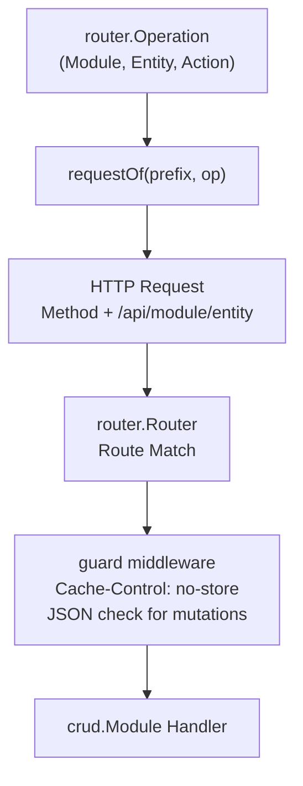

# REST Flow

How domain operations map to HTTP methods and paths, register on the router, pass through guard middleware, and reach the module handler. This flow is tested end-to-end in `tests/rest_test.go` and `tests/rpc_test.go`.

## Walkthrough

1. **Operation definition**: An operation is identified by `router.Operation{Module, Entity, Action}`.
2. **REST mapping (`requestOf`)**: Maps `model.Action` to an HTTP method (`POST` for Create, `GET` for Read, `PATCH` for Update, `DELETE` for Delete) and builds the resource path `<prefix>/<module>/<entity>`.
3. **HTTP transmission**: The client (`Caller`) sends the request over HTTP. For `GET`, arguments travel as URL query parameters (`router.EncodeQuery`). For mutations (`POST`, `PATCH`, `DELETE`), arguments travel as a JSON body.
4. **Router matching**: The server router matches the incoming method and path to the registered route.
5. **Guard middleware**: Sets `Cache-Control: no-store` on every response and rejects non-JSON mutations with HTTP 415.
6. **Execution**: The underlying `crud.Module` handler processes the request and returns the result.
